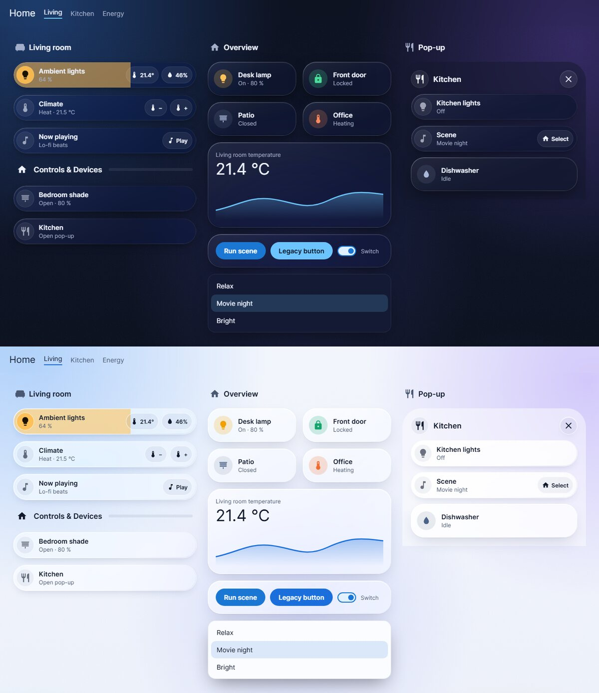

# Bubble Glass

A frosted-glass theme for Home Assistant with first-class [Bubble Card](https://github.com/Clooos/Bubble-Card) integration. One theme covers light and dark mode.

[](https://my.home-assistant.io/redirect/hacs_repository/?owner=benkl&repository=bubble-glass&category=theme)



<sub>Preview rendered from the theme's own tokens, dark mode above and light mode below.</sub>

## Contents

- [What you get](#what-you-get)
- [What you need](#what-you-need)
- [Quick start](#quick-start)
- [Step-by-step setup](#step-by-step-setup)
  1. [Enable YAML themes](#1-enable-yaml-themes)
  2. [Install the theme](#2-install-the-theme)
  3. [Turn the theme on](#3-turn-the-theme-on)
  4. [Install card-mod](#4-install-card-mod)
  5. [Install Bubble Card](#5-install-bubble-card)
  6. [Install the Bubble Card module](#6-install-the-bubble-card-module)
  7. [Build the dashboard](#7-build-the-dashboard)
- [Check that everything works](#check-that-everything-works)
- [Customizing](#customizing)
- [Troubleshooting](#troubleshooting)
- [Upgrading from v1.x](#upgrading-from-v1x)
- [How it works](#how-it-works)
- [Compatibility](#compatibility)
- [Uninstalling](#uninstalling)
- [License](#license)

## What you get

- **Frosted glass surfaces.** Each surface has a translucent tint, backdrop blur, a soft sheen, and a rim light. The rim light is a thin gradient edge, bright at the top-left like light catching real glass. Layered shadows add depth.
- **Aurora background.** Soft color glows sit behind the glass, and a fine grain stops gradient banding. The background stays put while cards scroll. It needs no network images, so it works offline.
- **One accent color everywhere.** A refined azure scale drives current Home Assistant buttons, switches, links, sliders, and focus rings. Button text stays readable in both modes.
- **Light and dark mode in one theme.** It follows your device, or you can pin a mode.
- **Bubble Card styling** through Bubble Card's own theme variables. An optional module adds blur, sheen, rim light, and glass footer buttons.
- **Readable everywhere.** Menus, pickers, and dropdown lists are solid. State colors (lights, climate, locks, alarms) are tuned separately for each mode.
- **Mobile and accessibility aware.** Phones get lighter blur. Surfaces turn solid when the OS asks for reduced transparency.

## What you need

| Component | Needed? | What it adds |
| --- | --- | --- |
| Home Assistant (current release) | Required | Colors, background, header and dialog blur, Bubble Card colors |
| [HACS](https://hacs.xyz/docs/use/download/download/) | Recommended | One-click install and updates |
| [card-mod](https://github.com/thomasloven/lovelace-card-mod) (4.x recommended) | Recommended | Blur, sheen, and rim light on standard Home Assistant cards; lighter phone blur; reduced-transparency fallback |
| [Bubble Card](https://github.com/Clooos/Bubble-Card) 3.2+ | For Bubble dashboards | Bubble Card rows, pop-ups, and footer |
| [Bubble Card Tools](https://github.com/Clooos/Bubble-Card-Tools) | For the module | Stores Bubble Card modules; needed for the Module Editor and import |

**Without card-mod or the module**, the theme still sets every color, edge, and shadow, plus the background, header blur, and dialog blur. You give up the blur, sheen, and rim light on cards and Bubble rows.

## Quick start

If you already have HACS, card-mod, and Bubble Card:

1. Add `themes: !include_dir_merge_named themes` under `frontend:` in `configuration.yaml`, then restart Home Assistant.
2. In **HACS → ⋮ → Custom repositories**, add `https://github.com/benkl/bubble-glass` with type **Theme**, then download **Bubble Glass**.
3. Run the `frontend.reload_themes` action, then pick **Bubble Glass** in your profile.
4. Import [`examples/bubble-glass-module.yaml`](examples/bubble-glass-module.yaml) in any Bubble Card editor: **Modules → My Modules → Import Module**.
5. Reload the page.

Each step is explained below.

## Step-by-step setup

### 1. Enable YAML themes

Home Assistant only loads theme files if `configuration.yaml` tells it where they are. Open `configuration.yaml`, using the File editor or Studio Code Server add-on, or Samba or SSH. Make sure it contains:

```yaml
frontend:
  themes: !include_dir_merge_named themes
```

- If you already have a `frontend:` block, add the `themes:` line to it. Don't create a second `frontend:` block.
- If you already have `themes: !include_dir_merge_named themes`, skip this step. Bubble Glass sits next to your other themes.
- If the `themes` folder doesn't exist in `/config/`, create it.

Restart Home Assistant (**Settings → System → power icon in the top right → Restart Home Assistant**). Reloading themes is not enough the first time.

### 2. Install the theme

#### Option A: HACS (recommended)

1. Open **HACS**, then **⋮ → Custom repositories**. Or click the **Open in HACS** badge at the top of this page.
2. Repository: `https://github.com/benkl/bubble-glass`. Type: **Theme**. Click **Add**.
3. Search for **Bubble Glass** in HACS, open it, and click **Download**.

HACS puts the file under `/config/themes/` and tells you when updates are available.

#### Option B: Manual

1. Download [`themes/bubble-glass.yaml`](themes/bubble-glass.yaml).
2. Copy it into `/config/themes/`.

You'll need to repeat this for updates.

### 3. Turn the theme on

1. Go to **Developer tools → Actions**, run `frontend.reload_themes`, and wait for the green check.
2. Click your user name at the bottom of the sidebar to open your **Profile**.
3. Under **Theme**, choose **Bubble Glass**. Then pick **Auto** to follow your device, or force **Light** or **Dark**.

The theme choice is saved per user and per browser or device. To make Bubble Glass the default for everyone, including wall tablets with no logged-in profile, use the `frontend.set_theme` action. To have it set on every start, use an automation:

```yaml
automation:
  - alias: "Default theme: Bubble Glass"
    triggers:
      - trigger: homeassistant
        event: start
    actions:
      - action: frontend.set_theme
        data:
          name: Bubble Glass          # default (light) theme
      - action: frontend.set_theme
        data:
          name: Bubble Glass
          mode: dark                  # default dark theme
```

To use the theme on a single dashboard view only, set it on that view (**Edit dashboard → view settings → Theme**):

```yaml
views:
  - title: Home
    theme: Bubble Glass
```

### 4. Install card-mod

card-mod adds the parts a plain theme can't: blur, sheen, and rim light on standard cards, the lighter phone blur, and the reduced-transparency fallback.

1. In **HACS**, search for **card-mod** and click **Download**. HACS adds the dashboard resource for you.
2. **Recommended:** also load card-mod as a frontend module. Theme rules then apply faster, and the sidebar is styled on every page, not only on dashboards. Find the exact URL HACS created under **Settings → Dashboards → ⋮ → Resources**. It looks like `/hacsfiles/lovelace-card-mod/card-mod.js?hacstag=…`. Add it to `configuration.yaml`:

   ```yaml
   frontend:
     themes: !include_dir_merge_named themes
     extra_module_url:
       - /hacsfiles/lovelace-card-mod/card-mod.js?hacstag=12345678901   # use your own URL
   ```

   Restart Home Assistant. Keep the HACS resource as well; Cast devices need it. When HACS updates card-mod, update the URL here too, so the file doesn't load twice.
3. Reload the browser page.

### 5. Install Bubble Card

Skip this step if you only want the theme for standard Home Assistant cards.

1. In **HACS**, search for **Bubble Card** and click **Download**.
2. Reload the browser page. **Bubble Card** now appears in the card picker.

Bubble Card picks up Bubble Glass automatically through its theme variables. Nothing else is needed for colors, edges, and shadows.

### 6. Install the Bubble Card module

The [Bubble Glass module](examples/bubble-glass-module.yaml) adds blur, sheen, and rim light to Bubble rows, edges to icon and sub-button chips, glass pop-up close buttons, and footer buttons that match the rows. It is a *global* module (`is_global: true`), so it applies to every Bubble Card at once.

Modules are stored by the **Bubble Card Tools** integration. Install it first if you haven't:

1. In **HACS**, search for **Bubble Card Tools** (an *Integration*) and click **Download**.
2. Restart Home Assistant.
3. Go to **Settings → Devices & services → Add integration**, search **Bubble Card Tools**, and add it. It creates `/config/bubble_card/modules/`.

Then install the module **one** of these ways:

- **Import (easiest):** open any Bubble Card in the dashboard editor and expand **Modules**. In **My Modules**, choose **Import Module** and paste the *whole* contents of [`bubble-glass-module.yaml`](examples/bubble-glass-module.yaml).
- **File copy:** save the file as `/config/bubble_card/modules/bubble_glass.yaml` and reload the page.
- **Legacy (no Bubble Card Tools):** merge the file's contents into `/config/bubble-modules.yaml` and restart Home Assistant.

Check that **Bubble Glass** shows **All cards** enabled in **My Modules**. HACS doesn't update modules, so after a theme update, re-import the module to get its latest version.

To leave one card out of the module, add this to that card's YAML:

```yaml
modules:
  - "!bubble_glass"
```

### 7. Build the dashboard

[`examples/bubble-card-dashboard.yaml`](examples/bubble-card-dashboard.yaml) is a complete example: Bubble rows, climate and media cards, a separator, a pop-up, and a footer. To try it, create a new dashboard (**Settings → Dashboards → Add dashboard**), open it, and choose **⋮ → Edit dashboard → ⋮ → Raw configuration editor**. Paste the example, then change the entity IDs to your own.

Settings that look best with this theme:

| Card | Setting | Value | Why |
| --- | --- | --- | --- |
| Pop-up | `bg_opacity` | `70`–`80` | Translucent sheet that still reads clearly |
| Pop-up | `bg_blur` | `20`–`28` | Frosted sheet over the dashboard |
| Pop-up | `shadow_opacity` | `25`–`35` | Lifts the sheet off the page |
| Pop-up | `backdrop_blur` | leave unset | Blurring the whole page *and* the sheet costs twice the GPU work |
| Horizontal buttons stack | `highlight_current_view` | `true` | The current page's button gets the accent color |
| Any card | `use_accent_color` | `true` | Uses the theme accent instead of the entity color |

## Check that everything works

| Look for | If it's missing |
| --- | --- |
| Dashboard background has soft color glows, not flat gray | Theme isn't active, or the view has its own `background:`. See [Troubleshooting](#troubleshooting). |
| Standard cards (tile, entities, graphs) blur what's behind them and have a bright top-left edge | card-mod isn't loaded |
| Bubble rows blur, have a sheen, and a bright top-left edge | Module isn't installed or isn't set to **All cards** |
| Primary buttons are azure with readable text | An older theme is still selected in your profile |
| Dropdown menus are solid | Normal. Only cards are glass. |

To check the theme from the browser console (F12 → Console):

```js
getComputedStyle(document.documentElement).getPropertyValue("--glass-surface")
// → "rgba(20, 25, 44, 0.46)" in dark mode, "rgba(255, 255, 255, 0.46)" in light mode
```

An empty result means Bubble Glass isn't the active theme on this page.

## Customizing

Don't edit the HACS-managed file; updates overwrite it. Make a copy instead:

1. Copy `bubble-glass.yaml` to `/config/themes/bubble-glass-custom.yaml`.
2. Rename the top-level key `Bubble Glass:` to `Bubble Glass Custom:`.
3. Change `card-mod-theme: "Bubble Glass"` to `card-mod-theme: "Bubble Glass Custom"`. It **must** match the theme name, or card-mod rules stop applying.
4. Run `frontend.reload_themes` and select **Bubble Glass Custom**.

### Design tokens

Every surface is built from a few `glass-*` tokens, defined once per mode:

| Token | Used for |
| --- | --- |
| `glass-surface` | Cards, Bubble rows, footer buttons |
| `glass-surface-solid` | Menus, pickers, dropdown lists; also the reduced-transparency fallback |
| `glass-surface-raised` | Dialogs and bottom sheets |
| `glass-chip` / `glass-chip-active` | Icon and sub-button chips; selected list item |
| `glass-border-color` | One-pixel base edge |
| `glass-rim` | Rim-light gradient drawn over the edge |
| `glass-sheen` | Light falloff across a surface |
| `glass-shadow` / `glass-shadow-row` / `glass-shadow-float` | Depth of cards, Bubble rows, and the floating footer |
| `glass-backdrop-filter` | Blur recipe (top level, shared by both modes) |

### Recipes

**More or less frosting.** Change the top-level blur:

```yaml
glass-backdrop-filter: "blur(30px) saturate(180%)"   # heavier
glass-backdrop-filter: "blur(12px) saturate(140%)"   # lighter
```

**More solid cards** for busy backgrounds. Raise the alpha (the last number) of `glass-surface` in each mode, for example `rgba(20, 25, 44, 0.65)` in dark mode.

**Your own background image.** Put the image in `/config/www/backgrounds/` and replace `lovelace-background` in both modes:

```yaml
lovelace-background: "center / cover no-repeat url('/local/backgrounds/home.jpg') fixed"
```

Keep the word `fixed`: it tells Home Assistant to pin the background while the cards scroll. To set a background for a single view, use the view's **Background** setting instead.

**No grain.** Delete the first layer of `lovelace-background`: the `url("data:image/svg+xml,…")` entry and the comma after it.

**Different accent color.** Set `primary-color` and `accent-color` in each mode. Then replace the eleven `ha-color-primary-05` … `ha-color-primary-95` steps at the top of the file with a scale in your hue, running from darkest (`05`) to lightest (`95`). Home Assistant fills primary buttons with step `40` and puts white text on them, so keep step `40` dark enough for at least 4.5:1 contrast with white. Set `text-primary-color` to a color that contrasts with your `primary-color`.

**Fast flat mode for slow wall tablets:**

```yaml
glass-backdrop-filter: "none"
# and in each mode:
glass-surface: "rgba(20, 25, 44, 0.85)"      # dark
glass-surface: "rgba(255, 255, 255, 0.85)"   # light
```

## Troubleshooting

**Bubble Glass doesn't appear in the theme list.**
Check that `themes: !include_dir_merge_named themes` is under `frontend:` and that you restarted after adding it. A YAML error in *any* file in the `themes` folder can stop all themes from loading. Check **Settings → System → Logs** for `themes` errors, then run `frontend.reload_themes`.

**The theme is selected, but the dashboard background is flat.**
The view or dashboard has its own background (view settings → **Background**, or `background:` in YAML), which overrides the theme. Remove it. Settings pages always use the plain page color; only dashboards show the aurora.

**Standard cards aren't blurred and have no bright edge.**
card-mod isn't loaded. Check **Settings → Dashboards → ⋮ → Resources** for `card-mod.js`, then hard-reload the page (Ctrl/Cmd + Shift + R). If one card has its own `card_mod:` style that sets `background` or `backdrop-filter`, it overrides the theme on that card.

**Bubble rows look flat, with no sheen, blur, or rim.**
The module isn't active. Open **Modules → My Modules** in any Bubble Card editor and check that **Bubble Glass** is installed with **All cards** on. If the editor warns about storage, set up Bubble Card Tools ([step 6](#6-install-the-bubble-card-module)).

**The Bubble Card footer moved into the page, scrolls away, or a dropdown opens in the wrong place.**
Something gave a Bubble Card a `backdrop-filter`, `filter`, or `transform`. Any of these traps Bubble Card's fixed footer and menus inside the card. Common causes: a `card_mod:` style on the Bubble Card, another theme or module that sets `--ha-card-backdrop-filter`, or an old copy of a v1 module. Bubble Glass deliberately never filters Bubble Card's outer card.

**The footer buttons have a double border.**
Remove any old per-card `styles:` block from earlier Bubble Glass READMEs on your `horizontal-buttons-stack`. The module styles the footer now.

**A transparent sub-button card or custom card got a frame or sheen.**
Exclude it from the module on that card with `modules: ["!bubble_glass"]`.

**Text is hard to read over my own background image.**
Raise the alpha of `glass-surface` (see [Recipes](#recipes)), or use a darker or blurrier image.

**Scrolling stutters on a wall tablet.**
Backdrop blur is GPU work. Use the [fast flat mode](#recipes), or lower `glass-backdrop-filter` to `blur(8px)`.

**Changes don't show up after an update.**
1. Run `frontend.reload_themes`.
2. Hard-reload the browser.
3. In the iOS Companion app, go to **Settings → Companion app → Debugging → Reset frontend cache**. On Android, clear the app cache in the system app settings.
4. Re-import the module; HACS doesn't update it.

**The wrong mode shows.**
**Auto** follows the device's light/dark setting. Pick **Light** or **Dark** in your profile to pin it. For devices with no profile, see `frontend.set_theme` with `mode:` in [step 3](#3-turn-the-theme-on).

## Upgrading from v1.x

1. Update through HACS and run `frontend.reload_themes`.
2. Re-import the module (**Modules → My Modules**): delete the old **Bubble Glass** entry, then import the new file.
3. Remove the per-card footer `styles:` block if you copied it from the v1 README.
4. If your own styles used Bubble Glass tokens, rename them:

| v1 token | v2 token |
| --- | --- |
| `glass-background` | `glass-surface` |
| `glass-background-strong` | `glass-surface-raised` |
| `glass-background-soft` | `glass-chip` |
| `glass-chip-background` | `glass-chip` |
| `glass-shadow` (single shadow) | `glass-shadow` (now includes highlights), `glass-shadow-row`, `glass-shadow-float` |
| `glass-highlight-color`, `glass-rim-color` | `glass-rim` (gradient) |

## How it works

| Layer | Where | What it does |
| --- | --- | --- |
| Theme variables | `themes/bubble-glass.yaml` | Colors, accent scale, background, card tint, edges, shadows, header and dialog blur, Bubble Card variables |
| card-mod rules | `card-mod-card`, `card-mod-root-yaml`, `card-mod-sidebar` in the same file | Blur, sheen, and rim light on standard cards; lighter blur on phones; reduced-transparency fallback; sidebar blur |
| Bubble Card module | `examples/bubble-glass-module.yaml` | Blur, sheen, and rim light on Bubble rows and footer buttons; chip edges; pop-up buttons |

The rules respect two constraints:

- **Never filter a Bubble Card's outer card.** `backdrop-filter` makes an element the containing block for its fixed-position children, which would pull Bubble Card's footer and menus out of place. card-mod skips `bubble-card`. The module blurs only the row's innermost background layer.
- **Leave Home Assistant's transparent cards alone.** Heading, toggle-group, and transparent clock and date cards get no blur, so no stray frosted boxes appear.

[`docs/research-and-plan.md`](docs/research-and-plan.md) records the source-level findings behind each decision.

## Compatibility

| Area | Status |
| --- | --- |
| Home Assistant | Current releases. The theme uses the `ha-font-family-*`, `ha-color-primary-*`, dialog, and header variables from the redesigned frontend. On older versions some variables are ignored, but nothing breaks. |
| Bubble Card | 3.2+ (pop-ups); checked against 3.4.3 |
| card-mod | 4.x recommended; checked against 4.2.1 |
| Chrome, Edge, Android WebView, Fully Kiosk | Full support |
| Safari / iOS Companion app | iOS/macOS 18+ for full blur. Older versions show the tinted glass without header blur. |
| Firefox | 103+ |

## Uninstalling

1. Pick another theme in your profile. If you added a `frontend.set_theme` automation, remove it too.
2. Delete the module in **Modules → My Modules**.
3. Remove the theme in HACS, or delete `/config/themes/bubble-glass.yaml`.
4. Run `frontend.reload_themes`.

## License

Derived from the MIT-licensed Bubble theme by Clooos. Distributed under the [MIT License](LICENSE).
